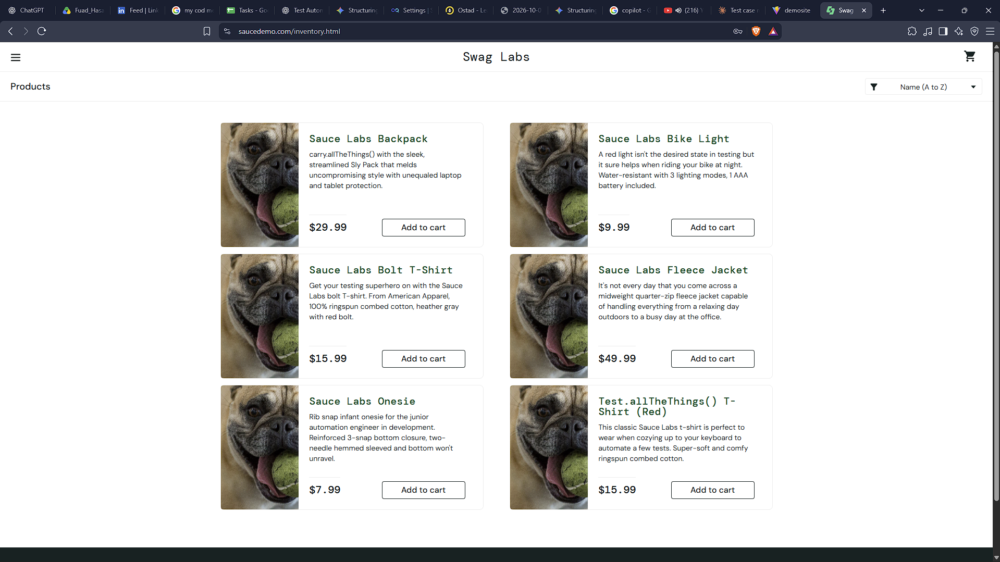
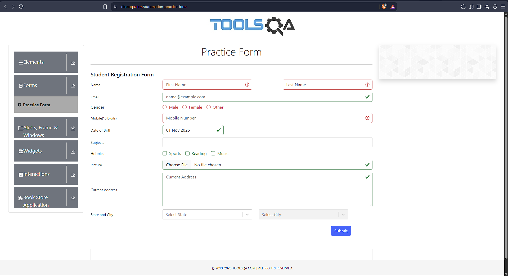

# SauceDemo, DemoQA & Mobile App: Manual Testing

Manual functional, UI and mobile testing completed for the Ostad SQA course (Batch 18). The project covers 18 test cases across two web applications and one Android app, with 6 documented defects and screenshot evidence.

## Applications tested

| Section | Application | Focus |
|---|---|---|
| A | [SauceDemo](https://www.saucedemo.com/) | Login, cart, checkout validation, product listing |
| B | [DemoQA](https://demoqa.com/) | Form validation, JS alerts, web tables, boundary values |
| C | [Sauce Labs My Demo App RN](https://github.com/saucelabs/my-demo-app-rn/releases) | Login, cart, orientation change, app state, offline behavior |

## Results

| Metric | Count |
|---|---|
| Total test cases | 18 |
| Passed | 13 |
| Failed | 5 |
| Defects logged | 6 (1 High, 2 Medium, 3 Low) |

Failed test cases: TC_A_SD_004, TC_B_DA_005, TC_B_DA_011, TC_C_MAT_016, TC_C_MAT_018.

## Defects found

| Bug | Application | Summary | Severity |
|---|---|---|---|
| BUG-001 | SauceDemo | Same image shown for every product (problem_user) | Medium |
| BUG-002 | SauceDemo | Page lags/freezes; filter and remove not usable (problem_user) | High |
| BUG-003 | DemoQA | State and City show no validation error on empty submit | Low |
| BUG-004 | DemoQA | Add Record name fields accept symbols and numbers without warning | Low |
| BUG-005 | My Demo App RN | UI layout does not adapt to landscape orientation | Low |
| BUG-006 | My Demo App RN | No offline message when internet is disabled | Medium |

Full steps, expected and actual results: [bug-reports/Bug_Reports.md](bug-reports/Bug_Reports.md)

### Evidence preview

| BUG-001: same image on every product | BUG-003: no error on State/City |
|---|---|
|  |  |

## Test cases

All 18 test cases, with steps, expected results, actual results and status: [manual-tests/Test_Cases.md](manual-tests/Test_Cases.md). The same cases are also available as an Excel sheet: [manual-tests/Sauce_demo_manual_tests.xlsx](manual-tests/Sauce_demo_manual_tests.xlsx).

## Techniques used

- Boundary value analysis (maximum text length and salary value in DemoQA Web Tables)
- Negative testing (blocked browser alert, invalid characters in name fields)
- Input validation (special characters and numbers, empty form submission)
- Exploratory testing of the mobile app
- State preservation (minimizing and reopening the app)
- Orientation change and offline behavior testing

## Test environment

- Web: Chrome 156 on Windows 11 Pro
- Mobile: Android 9, Redmi Note 5 Pro
- Test date: 12/06/2026

## Repository contents

```
├── README.md
├── manual-tests/
│   ├── Test_Cases.md        # 18 test cases
│   └── Sauce_demo_manual_tests.xlsx
└── bug-reports/
    ├── Bug_Reports.md       # 6 defects with evidence
    ├── Bug_Reports.xlsx     # same defects as a spreadsheet
    └── Evidences/           # screenshots
```

## Tools

Microsoft Excel, Google Chrome, Android device, Markdown

## Author

Fuad Hasan | [GitHub](https://github.com/quditor)