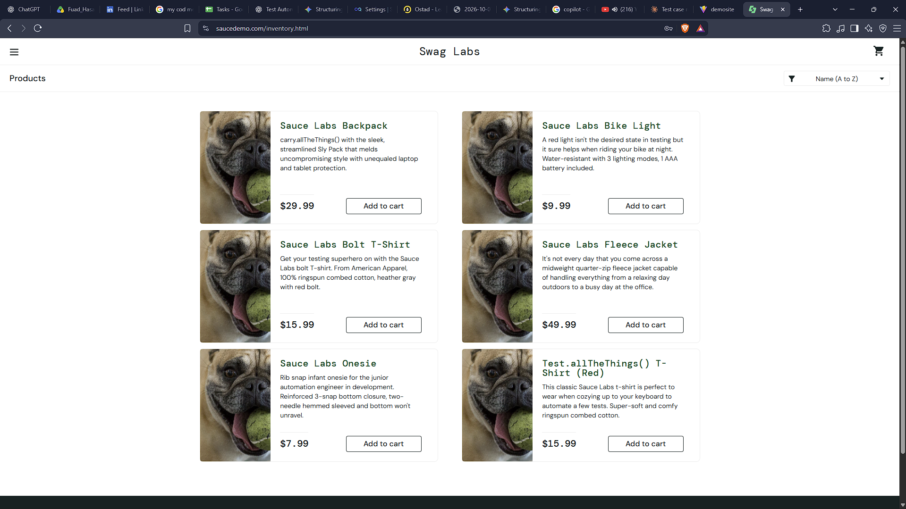
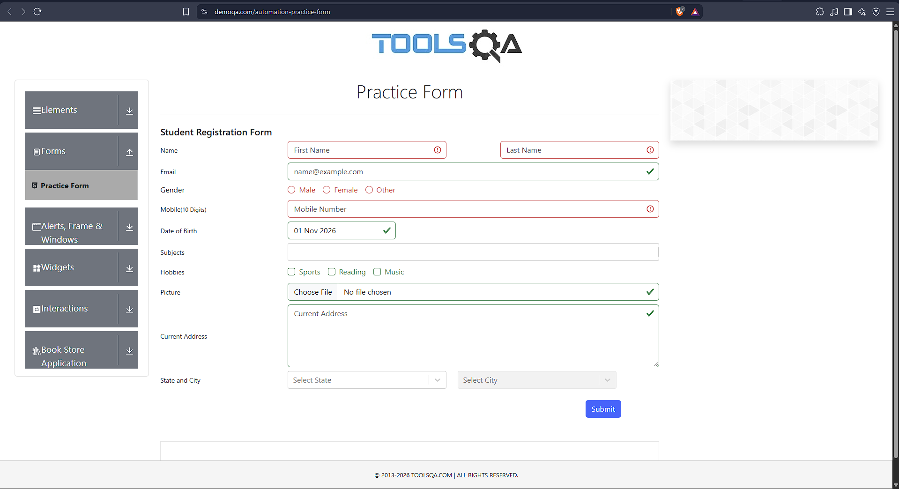
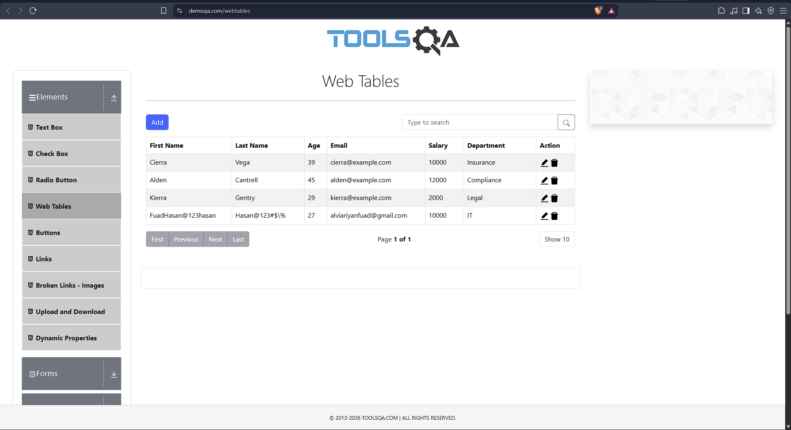

# Bug Reports

Defects found during manual testing of SauceDemo, DemoQA and the Sauce Labs My Demo App RN (SQA Batch 18, tested 12/06/2026). Source test cases: [../test-cases/Test_Cases.md](../test-cases/Test_Cases.md).

## Summary

6 defects: 1 High, 2 Medium, 3 Low.

| Bug ID | Application | Test case | Title | Severity | Status |
|---|---|---|---|---|---|
| [BUG-001](#bug-001) | SauceDemo | TC_A_SD_004 | Same image shown for every product (problem_user) | Medium | Open |
| [BUG-002](#bug-002) | SauceDemo | TC_A_SD_004 | Page lags/freezes; filter and remove not usable (problem_user) | High | Open |
| [BUG-003](#bug-003) | DemoQA | TC_B_DA_005 | State and City show no validation error on empty submit | Low | Open |
| [BUG-004](#bug-004) | DemoQA | TC_B_DA_011 | Add Record name fields accept symbols and numbers without any warning | Low | Open |
| [BUG-005](#bug-005) | My Demo App RN | TC_C_MAT_016 | UI layout does not adapt to landscape orientation | Low | Open |
| [BUG-006](#bug-006) | My Demo App RN | TC_C_MAT_018 | No offline message when internet is disabled | Medium | Open |

---

## BUG-001

**Same image shown for every product (problem_user)**

| Field | Details |
|---|---|
| Application | SauceDemo |
| Link | https://www.saucedemo.com/ |
| Test case | TC_A_SD_004 |
| Severity | Medium |
| Status | Open |
| Date tested | 12/06/2026 |
| Environment | Chrome 156.0.8078.74 (Official Build) (64-bit), Windows 11 Pro |

**Preconditions:** SauceDemo is live; login page is available

**Steps to reproduce**

1. Open Chrome and go to https://www.saucedemo.com/
2. Enter username: problem_user
3. Enter password: secret_sauce
4. Click Login
5. Browse the inventory page
6. Try to filter or remove items

**Expected result:** Each product shows its own image; buttons respond.

**Actual result:** Images are broken: every product shows the same dog image.

**Evidence**

---

## BUG-002

**Page lags/freezes; filter and remove not usable (problem_user)**

| Field | Details |
|---|---|
| Application | SauceDemo |
| Link | https://www.saucedemo.com/ |
| Test case | TC_A_SD_004 |
| Severity | High |
| Status | Open |
| Date tested | 12/06/2026 |
| Environment | Chrome 156.0.8078.74 (Official Build) (64-bit), Windows 11 Pro |

**Preconditions:** SauceDemo is live; login page is available

**Steps to reproduce**

1. Open Chrome and go to https://www.saucedemo.com/
2. Enter username: problem_user
3. Enter password: secret_sauce
4. Click Login
5. Browse the inventory page
6. Try to filter or remove items

**Expected result:** The page is fully responsive for filtering and removing items.

**Actual result:** Page lags/freezes when trying to filter or remove items.

**Evidence**

---

## BUG-003

**State and City show no validation error on empty submit**

| Field | Details |
|---|---|
| Application | DemoQA |
| Link | https://demoqa.com/automation-practice-form |
| Test case | TC_B_DA_005 |
| Severity | Low |
| Status | Open |
| Date tested | 12/06/2026 |
| Environment | Chrome 156.0.8078.74 (Official Build) (64-bit), Windows 11 Pro |

**Preconditions:** User is on the Practice Form page

**Steps to reproduce**

1. Open Chrome and go to https://demoqa.com/automation-practice-form
2. Click Submit without filling any field

**Expected result:** All mandatory fields (Name, Gender, Mobile, State/City) show validation errors.

**Actual result:** Name, Gender and Mobile show errors; State and City dropdowns do not.

**Evidence**

---

## BUG-004

**Add Record name fields accept symbols and numbers without any warning**

| Field | Details |
|---|---|
| Application | DemoQA |
| Link | https://demoqa.com/webtables |
| Test case | TC_B_DA_011 |
| Severity | Low |
| Status | Open |
| Date tested | 12/06/2026 |
| Environment | Chrome 156.0.8078.74 (Official Build) (64-bit), Windows 11 Pro |

**Preconditions:** User is on the Web Tables page and has clicked Add

**Steps to reproduce**

1. Open Chrome and go to https://demoqa.com/webtables
2. Click Add
3. Enter FuadHasan@123hasan in First Name
4. Enter `Hasan@123#$\%` in Last Name
5. Fill the other fields validly and click Submit

**Expected result:** The system prevents non-alphabetic characters in name fields, or stores and shows them as plain text without errors.

**Actual result:** The modal accepts the input, submits without warning, and saves the symbols/numbers into the table.

**Evidence**

---

## BUG-005

**UI layout does not adapt to landscape orientation**

| Field | Details |
|---|---|
| Application | My Demo App RN |
| Link | https://github.com/saucelabs/my-demo-app-rn/releases |
| Test case | TC_C_MAT_016 |
| Severity | Low |
| Status | Open |
| Date tested | 12/06/2026 |
| Environment | Android 9, Redmi Note 5 Pro |

**Preconditions:** App is installed and running on an Android device

**Steps to reproduce**

1. Launch My Demo App
2. Enter username: bob@example.com
3. Enter password: 10203040
4. Tap Login
5. Open the app in Portrait mode
6. Rotate the device to Landscape mode

**Expected result:** The UI layout adjusts to the new orientation without clipping elements.

**Actual result:** Layout fails to adapt; UI remains in Portrait mode.

**Evidence:** screenshot to be added.

---

## BUG-006

**No offline message when internet is disabled**

| Field | Details |
|---|---|
| Application | My Demo App RN |
| Link | https://github.com/saucelabs/my-demo-app-rn/releases |
| Test case | TC_C_MAT_018 |
| Severity | Medium |
| Status | Open |
| Date tested | 12/06/2026 |
| Environment | Android 9, Redmi Note 5 Pro |

**Preconditions:** App is connected to the network

**Steps to reproduce**

1. Launch My Demo App
2. Enter username: bob@example.com
3. Enter password: 10203040
4. Tap Login
5. Load the product catalog
6. Disable internet connectivity on the device

**Expected result:** The app displays a meaningful "No Internet" or "Offline" message.

**Actual result:** App keeps the last viewed state; no notification of the network change.

**Evidence:** screenshot to be added.
